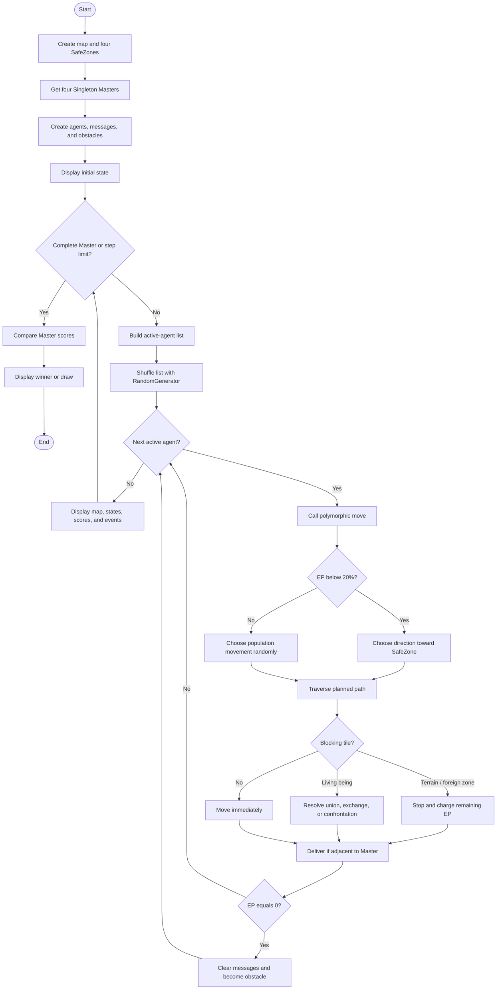

# Hogwarts: The Battle for Lost Spells

## Concept Objet — Practical Lab

**Team members:** `[NAME 1]`, `[NAME 2]`, `[NAME 3]`, `[NAME 4]` 
**Group referee:** `[REFEREE NAME]` 
**Academic year:** 2026–2027

This project is a discrete multi-agent simulation written in Java and set at Hogwarts. Gryffindor, Hufflepuff, Ravenclaw, and Slytherin students explore a shared two-dimensional map, exchange or capture spells, manage their energy, and return knowledge to their stationary House Master. The winner is the house whose Master has collected the most distinct spells.

**Implementation:** Java 21 console application 
**Main design pattern:** Singleton (one Master per population) 
**Simulation model:** discrete, immediate-update multi-agent system

# 1. Requirements and design choices

The simulation uses an 18×12 grid and four 3×3 SafeZones. Their combined area is 36 tiles, below half the map's 216 tiles. Every tile holds at most one obstacle or living being. Sixteen original messages are distributed among sixteen mobile agents. Each step shuffles the active-agent list and invokes every agent's polymorphic `move()` operation. Changes apply immediately, so later agents see the current state.

Ravenclaw students move diagonally by up to three tiles, Hufflepuff students move orthogonally by up to three, Gryffindor students use all directions for up to two, and Slytherin students use all directions for up to three. Movement outside a Common Room/SafeZone costs one EP per planned tile. When terrain blocks a route, untraveled tiles also cost EP. Below 20 EP, a student heads toward its own Common Room. It recovers there and rests when below 60 EP. At 0 EP it loses its spells, stops acting, and remains as an obstacle.

Agents meet only when another being blocks their planned path. Members of one population unite their knowledge. Different populations in one alliance copy one or two randomly selected unknown messages. Opponents compare combat strength plus a die roll; the winner transfers up to three unknown messages from the loser. Foreign SafeZones cannot be entered and confrontations cannot occur inside them. A Master receives all messages carried by an adjacent member of its population.

Encapsulation appears in private state and controlled methods such as `MessageStore.addAll`. Inheritance groups all entities under `LivingBeing`, all mobile entities under `MobileIndividual`, and the houses under `GoldAllianceMember` or `SilverAllianceMember`. Polymorphism lets `Simulation` call `move()` without testing a student's concrete type. `GryffindorMaster`, `HufflepuffMaster`, `RavenclawMaster`, and `SlytherinMaster` use Singleton construction because exactly one Master may exist per house.

# 2. Complete UML class diagram

```mermaid
classDiagram
direction TB
class Main { -DEFAULT_MAX_STEPS: int$ -Main() +main(args: String[]) void$ -printUsage() void$ }
class Simulation { -AGENTS_PER_POPULATION: int$ -MESSAGE_COUNT: int$ -map: WorldMap -random: RandomGenerator -maximumSteps: int -delayMillis: long -agents: List~MobileIndividual~ -masters: Map~Population,Master~ -events: List~String~ +Simulation(width,height,maximumSteps,delayMillis,seed) -initialize() void -createMasters() void -createPopulation(population,factory) void +run() void +resolveEncounter(mover,encountered) void -confront(first,second) void -copyRandomMessages(source,target,maximum) int -transferRandomMessages(source,target,maximum) int +deliverToMaster(agent) void +log(event) void -hasCompleteMaster() boolean -printState(step) void -printResult(completedSteps) void -printInstanceCounts() void -pause() void +map() WorldMap +random() RandomGenerator }
class LivingBeing { -NEXT_ID: AtomicInteger$ -instanceCount: int$ -id: int -population: Population -knowledge: MessageStore -position: Position #LivingBeing(population,position) +id() int +name() String +population() Population +alliance() Alliance +position() Position ~setPosition(position) void +knowledge() MessageStore +instanceCount() int$ +mapSymbol() char* }
class MobileIndividual { +MAX_ENERGY: int$ -LOW_ENERGY_THRESHOLD: int$ -instanceCount: int$ -energy: int -lastDirection: Direction -lastMoveBlocked: boolean -active: boolean #MobileIndividual(population,position) +move(simulation) void* #performMove(simulation,directions,maxDistance) void -exhaustIfNecessary(simulation) void -spendEnergy(amount) void -recoverEnergy(amount) int +energy() int +lastDirection() Direction +isActive() boolean +instanceCount() int$ +combatStrength() int* +mapSymbol() char }
class GoldAllianceMember { -instanceCount: int$ #GoldAllianceMember(population,position) +instanceCount() int$ }
class SilverAllianceMember { -instanceCount: int$ #SilverAllianceMember(population,position) +instanceCount() int$ }
class Gryffindor { -instanceCount: int$ +Gryffindor(position) +move(simulation) void +combatStrength() int +instanceCount() int$ }
class Hufflepuff { -instanceCount: int$ +Hufflepuff(position) +move(simulation) void +combatStrength() int +instanceCount() int$ }
class Ravenclaw { -instanceCount: int$ +Ravenclaw(position) +move(simulation) void +combatStrength() int +instanceCount() int$ }
class Slytherin { -instanceCount: int$ +Slytherin(position) +move(simulation) void +combatStrength() int +instanceCount() int$ }
class Master { -instanceCount: int$ #Master(population,position) +mapSymbol() char +receiveMessages(messenger) int +instanceCount() int$ }
class GryffindorMaster { -instance: GryffindorMaster$ -instanceCount: int$ -GryffindorMaster(position) +getInstance(position) GryffindorMaster$ +instanceCount() int$ }
class HufflepuffMaster { -instance: HufflepuffMaster$ -instanceCount: int$ -HufflepuffMaster(position) +getInstance(position) HufflepuffMaster$ +instanceCount() int$ }
class RavenclawMaster { -instance: RavenclawMaster$ -instanceCount: int$ -RavenclawMaster(position) +getInstance(position) RavenclawMaster$ +instanceCount() int$ }
class SlytherinMaster { -instance: SlytherinMaster$ -instanceCount: int$ -SlytherinMaster(position) +getInstance(position) SlytherinMaster$ +instanceCount() int$ }
LivingBeing <|-- MobileIndividual
MobileIndividual <|-- GoldAllianceMember
MobileIndividual <|-- SilverAllianceMember
GoldAllianceMember <|-- Gryffindor
GoldAllianceMember <|-- Hufflepuff
SilverAllianceMember <|-- Ravenclaw
SilverAllianceMember <|-- Slytherin
LivingBeing <|-- Master
Master <|-- GryffindorMaster
Master <|-- HufflepuffMaster
Master <|-- RavenclawMaster
Master <|-- SlytherinMaster
Simulation o-- WorldMap
Simulation o-- RandomGenerator
Simulation o-- MobileIndividual
Simulation o-- Master
LivingBeing *-- MessageStore
LivingBeing --> Population
LivingBeing --> Position
```

# 3. Supporting classes and agent state machine

```mermaid
classDiagram
direction LR
class WorldMap { -SAFE_ZONE_SIZE: int$ -width: int -height: int -obstacles: boolean[][] -occupants: LivingBeing[][] -safeZones: Map +WorldMap(width,height) -createSafeZones() void +width() int +height() int +safeZone(population) SafeZone +isInside(position) boolean +safeZoneOwner(position) Population +canEnter(position,population) boolean +isObstacle(position) boolean +occupantAt(position) LivingBeing +isEmpty(position) boolean +place(being) void +move(being,destination) void +neighborPositions(center) List +availableNeighbors(center,population) List +directionToSafeZone(from,population) Direction +masterCorner(population) Position +generateObstacles(amount,random) void +render() String }
class SafeZone { -owner: Population -minimumX: int -maximumX: int -minimumY: int -maximumY: int +SafeZone(owner,minX,maxX,minY,maxY) +owner() Population +contains(position) boolean }
class MessageStore { -messages: Set~String~ +MessageStore() +add(message) boolean +addAll(messages) int +remove(message) boolean +clear() void +size() int +contains(message) boolean +view() Set +unknownTo(other) List }
class RandomGenerator { -seed: long -random: Random +RandomGenerator(seed) +seed() long +between(min,max) int +choose(values) T +shuffle(values) void }
class Position { +x: int +y: int +Position(x,y) +move(direction) Position +isAdjacentTo(other) boolean }
class Direction { NORTH NORTH_EAST EAST SOUTH_EAST SOUTH SOUTH_WEST WEST NORTH_WEST +ALL: List~Direction~$ +CARDINAL: List~Direction~$ +DIAGONAL: List~Direction~$ -dx: int -dy: int -Direction(dx,dy) +dx() int +dy() int +toward(from,to) Direction$ }
class Population { GRYFFINDOR HUFFLEPUFF RAVENCLAW SLYTHERIN -displayName: String -alliance: Alliance -masterSymbol: char -agentSymbol: char -Population(displayName,alliance,masterSymbol,agentSymbol) +displayName() String +alliance() Alliance +masterSymbol() char +agentSymbol() char }
class Alliance { GOLDEN SILVER -displayName: String -Alliance(displayName) +displayName() String }
WorldMap *-- SafeZone
WorldMap --> Position
WorldMap --> Direction
Population --> Alliance
RandomGenerator --> Simulation
```

```mermaid
stateDiagram-v2
[*] --> Exploring: created with 100 EP
Exploring --> Exploring: EP >= 20 / random move
Exploring --> Returning: EP < 20
Returning --> Returning: move toward SafeZone
Returning --> Recovering: enters own SafeZone
Recovering --> Recovering: EP < 60 / rest +25 EP
Recovering --> Exploring: EP >= 60
Exploring --> Exhausted: EP reaches 0
Returning --> Exhausted: EP reaches 0
Exhausted --> [*]: inactive obstacle; messages cleared
```

# 4. Global activity diagram

Immediate updates are important: movement, energy use, encounters, message transfer, delivery, and exhaustion finish before the next agent acts. This matches the required discrete simulation semantics.

# 5. Validation, Singleton, and team roles

`RandomGenerator` owns every pseudo-random operation, including starting positions, initial message allocation, obstacles, turn order, directions, distances, encounter quantities, and combat rolls. Passing `--seed=N` reproduces a run. The default 120-step limit guarantees termination if messages become unavailable after exhaustion.

The console is the requested graphical representation. It prints the grid, a legend, EP and spell counts for all students, each Master's score, and detailed events. `G/H/R/S` identify House Masters, lowercase letters identify students, `:` identifies Common Rooms, `#` identifies obstacles, and `X` identifies exhausted students.

Compilation was validated with Java 21 and all lint warnings enabled. Deterministic end-to-end checks produced these results:

| Seed | End step | Result |
|---:|---:|---|
| 7 | 104 | Slytherin, 16/16 spells |
| 42 | 68 | Gryffindor, 16/16 spells |
| 2026 | 101 | Slytherin, 16/16 spells |

The Singleton pattern prevents a second Master of a house: each concrete Master has a private constructor, a private static instance, and a public static `getInstance` operation. Static counters show one instance of each House Master and the number of instances in the entity hierarchy.

**Anonymous role allocation (replace with the group's real allocation):**

- Member A — architecture, inheritance hierarchy, and Singleton design.
- Member B — map, movement, SafeZones, obstacles, and energy calibration.
- Member C — encounters, message rules, simulation loop, and console display.
- Member D — validation, diagrams, report integration, and final packaging.

Run with `javac -d out src/*.java`, then `java -cp out Main --seed=42 --steps=120 --delay=200`. The submission intentionally contains none of the bonus features.

